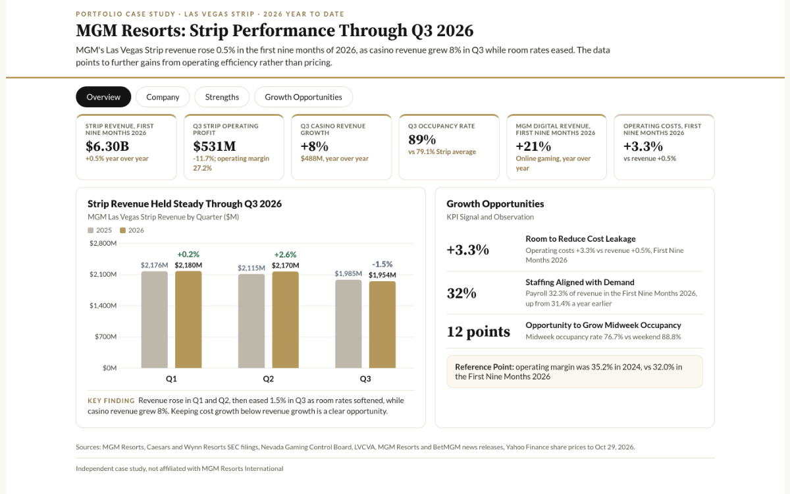

# MGM Resorts: Strip Performance Through Q3 2026



**Live dashboard:** https://rituneupane.github.io/mgm-strip-performance/ · **Repository:** https://github.com/rituneupane/mgm-strip-performance · **Sources:** [SOURCES.md](SOURCES.md)

MGM's Las Vegas Strip revenue rose 0.5% in the first nine months of 2026, as casino revenue grew 8% in Q3 while room rates eased. The data points to further gains from operating efficiency rather than pricing.

## Dashboard tabs

| Tab | What it shows |
|---|---|
| Overview | 2026 KPIs, Strip revenue by quarter, Growth Opportunities summary |
| Company | Snapshot, timeline of major events, one peer revenue view, 1 year share price, 3 year revenue, 2026 current events |
| Strengths | Q3 2026 Strip casino results, Strip room rates, growth across the company |
| Growth Opportunities | Independent observations with KPI signal and reference point, KPIs to watch |

## Company snapshot

- Casino resorts on the Las Vegas Strip (9 resorts), in US regional markets and in Macau, plus online gaming through MGM Digital and BetMGM. About 78,000 employees (Dec 31, 2025).
- Company revenue grew from **$16.2B** (2023) to **$17.5B** (2025).
- 2026 current events: Q3 revenue of $4.2B, with record MGM China revenue and $34M from BetMGM (Oct 28); Four Sixes Ranch Steakhouse coming to MGM Grand in early 2027 (Oct 22); Las Vegas Grand Prix race week, Nov 19 to 21.

## 2026 Year to Date: Strengths
1. **Revenue held steady.** Strip revenue rose in Q1 2026 (**$2,180M**, +0.2% year over year) and Q2 2026 (**$2,170M**, +2.6%), then eased 1.5% in Q3 2026 (**$1,954M**) as room rates softened. First nine months revenue was **$6.30B** (+0.5%).
2. **Casino revenue.** Q3 casino revenue rose **8%** to $488M, with table games drop up 5.3% and table games win up 17.5% (win rate 25.3% vs 22.6%). Q2 casino revenue rose 17% to $536M.
3. **Occupancy rate.** MGM's Strip occupancy rate was **89%** in Q3 2026, in line with Q3 2025, vs about 79% for the Strip average (LVCVA, July to September).
4. **Operating profit.** Q3 operating profit was **$531M** (27.2% margin), down 11.7% from $601M, mainly on lower room rates and higher payroll. First nine months operating profit was $2.02B (32.0% margin). MGM said October has rebounded favorably.
5. **Company growth.** Company revenue was **$13.1B** in the first nine months of 2026 (+1.4%). MGM Digital revenue grew 20.8% and MGM China revenue 4.2%, with record quarterly revenue and a 17.1% market share in Q3. MGM's share of BetMGM operating income was $57M, vs $30M a year earlier.
6. **Convention demand.** Las Vegas convention attendance is up 10.5% year to date (January to August 2026) and up 9.6% through September.

Data through Q3 2026 (MGM release Oct 28, 2026). Las Vegas market charts use LVCVA data through August 2026; September Strip occupancy (80.1%) is used for the Q3 Strip average.

## Growth Opportunities
Independent observations on cost efficiency that would not change quality, service or the guest experience. No pricing suggestions and no dollar estimates. Reference points are MGM's own recent results, not targets or company guidance.

| # | KPI Signal | Observation | Reference Point |
|---|---|---|---|
| 1 | Operating costs +3.3% vs revenue +0.5% in the First Nine Months 2026; Q3 2026 operating profit down 11.7% on revenue down 1.5% | **Room to reduce cost leakage.** Spend guests never see, such as energy, purchasing and back office, may offer savings | Operating margin was 35.2% in 2024 |
| 2 | Payroll as % of revenue 32.3% in the First Nine Months 2026, up from 31.4% a year earlier (31.1% in 2025, 29.9% in 2024) | **Staffing aligned with demand.** Demand based scheduling could shorten peak wait times while protecting service | Payroll was 29.9% of revenue in 2024 |
| 3 | Midweek occupancy rate 76.7% vs weekend 88.8% (Las Vegas, January to August 2026); convention attendance +10.5% | **Opportunity to grow midweek occupancy.** Conventions, entertainment and MGM Rewards packages could fill more weeknights; convention visitors spend 46% more per trip | A third of the gap equals about 4 percentage points |

Operating margin: 36.3% (2023), 35.2% (2024), 33.9% (2025), 32.0% (First Nine Months 2026).

## Data and method
- **Sources (public, primary, collected October 2026):** MGM Resorts Q1, Q2 and Q3 2026 earnings releases and Q3 2026 Form 10-Q, FY2025 Form 10-K and 2025 quarterly releases (SEC EDGAR); Caesars Entertainment and Wynn Resorts FY2025 Form 10-K (company revenue for the Company tab peer view only); Nevada Gaming Control Board (NGCB) monthly revenue reports; Las Vegas Convention and Visitors Authority (LVCVA) 2026 year-to-date summary (January to August) and September 2026 Strip occupancy, year-end summaries and 2025 Visitor Profile Study.
- **Scope:** MGM's Las Vegas Strip Resorts segment (9 resorts, about 37,000 rooms), with brief company-wide context. MGM Digital mainly reflects LeoVegas (acquired 2022); BetMGM is a 50/50 joint venture with Entain, reported separately under the equity method.
- **Comparisons:** MGM's room rate and occupancy are company reported; the Strip averages are LVCVA survey figures, so treat the gap as directional.
- **Terms:** Operating profit = MGM's reported Segment Adjusted EBITDAR (before rent, interest, taxes, depreciation and amortization). Operating margin = operating profit as % of revenue. Operating costs = revenue minus operating profit. First Nine Months = January to September.

## Repo
```
data/            source CSVs (each row has a source_id), highlights.csv, lvcva_ytd2026.csv
data/raw/        LVCVA xlsx downloads
analysis/        extract_lvcva.py, build.py (highlights, KPI signals, data.js),
                 write_sources.py, screenshots.js, social.js
docs/            GitHub Pages dashboard (index.html, data.js, company.js)
screenshots/     dashboard at 1280px and 390px
images/          dashboard page images (report.png = Overview, company.png, strengths.png, opportunities.png)
```
Rebuild: `python analysis/extract_lvcva.py && python analysis/build.py && python analysis/write_sources.py`. Screenshots and images need Node with `puppeteer-core`.

*Independent case study, not affiliated with MGM Resorts International. Built from public filings and public market data.*
